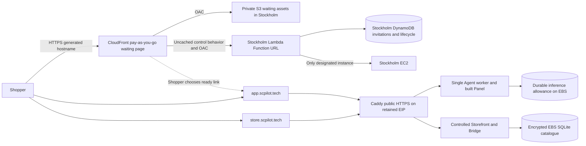

# Stockholm-only HTTPS and optional wake amendment

**19 October 2026 — owner-approved design choice.** No resource creation,
certificate requests, DNS writes, model calls or account changes are authorized
by this document. It amends the network candidate, not the shopping contract.

## Owner continuation — 20 October

The owner could not reach Support and approved continuing with available evidence.
Prepare the [conditional handoff](../../cap04-deployment-handoff.md) without another
Support response. Public IPv4 credit applicability remains unknown. This permits
preparation while local02 is open, not final09/parent closure, paid calls, cash
charges, account upgrade, resource creation or DNS writes. All existing shopping
and lifecycle safety requirements remain unchanged.

## Evidence requiring this change

The owner reached the ACM certificate list in eu-north-1. After changing the
existing session-qualified console hostname to us-east-1, AWS showed an explicit
modal: Virginia is unavailable, the project is assigned to Stockholm, and other
commercial Regions require a plan upgrade followed by advanced features.

This is stronger account-specific evidence than a generic policy interpretation.
The published Region SCP's ACM exception is not proof of console/action authority.
Do not try issuing a certificate through another API to bypass this restriction.
The owner retains the Free plan and USD0 cash constraint. The two custom-domain
CloudFront candidates relying on Virginia ACM are not currently qualified for
this account; a listing page or Request button cannot establish otherwise.

## Proposed topology

Testers must use the generated startup link for cold entry. A direct app/store bookmark cannot wake the stopped host or display a waiting page; while the instance is stopped it is unavailable. No DNS redirect or always-on shopping proxy is implied.

CloudFront serves only the waiting page/control path at its generated domain.
It is not in the shopping data path. The two shopping DNS A records target a
retained EIP. No cross-Region ACM certificate or custom CloudFront alias is used.
No shopper session or cart cookie is moved to the generated domain. No AWS key,
invitation code, grant, context ID or task authority appears in a redirect URL.

The waiting service validates an invitation before requesting startup, then the
Shopper enters it again inside the Copilot. Waiting authority does not authorize
shopping Actions. The generated host is a top-level startup page, not an iframe
shopping origin. This preserves distinct same-site shopping origins and the
existing exact origin/source checks. The existing separate trust/reentry contract
still applies; do not add wildcard CORS or shared-domain cookies.

The waiting UI offers a ready link to the fixed allowlisted app origin. This is
ordinary Shopper navigation, not an Agent off-origin Action. Status polling has
the existing deadline and never starts the instance. Requests finish promptly;
accepted work, drain fencing and generation/lease authority preserve safe idle
shutdown after 60 minutes. Manual owner start/prewarming remains the fallback.

## Certificates, ingress and maintenance

Use Caddy's automatic public ACME HTTPS for the two owned shopping names. Authoritative
DNS must point at the EIP; public challenge ports and outbound certificate-issuer
access must be permitted and verified. The current evaluation Caddyfile explicitly
uses static test certificates and disables automatic HTTPS, so this needs a
separately tested deployment configuration. Do not deploy that test certificate
file or claim automatic renewal already works.

Persist Caddy certificate/key/account state in a restricted external directory
on encrypted EBS across instance stop/start and release rollback. Certificate
expiry/renewal must remain visible; prewarm and verify HTTPS before public testing.
No certificate bootstrap or renewal occurs while the instance is stopped. On
restart require trusted app/store HTTPS and actual application readiness before
the waiting service declares ready. Never suppress browser TLS errors.

Direct public shopping ingress requires the existing invitation, request/body/rate,
session/SSE, queue and shared allowance controls. Restrict administrative ingress
separately; only the intended public proxy ports are exposed. Keep application,
private service and test routes protected as in the approved local release.
No claim is made that removing CloudFront supplies a WAF or volumetric abuse cap.

A public subnet plus retained EIP and IGW supplies maintenance/artifact/model
outbound HTTPS without a NAT gateway. Keep Lambda outside the VPC; no standing
server or NAT is introduced solely for wake. Use a same-Region private S3 REST
origin with OAC, not public bucket website hosting. Use the Lambda URL AWS_IAM/OAC
path only if available to this account; otherwise choose manual start.

Remote durable control storage, scoped runtime/controller IAM, code revalidation,
health/readiness transport and lifecycle races still require implementation and
cloud qualification. The locally tested shared-filesystem adapter cannot be
deployed as the remote authority. This amendment adds no live cloud code.

## Price and alternative

Using the [19 October verified rates and assumptions](../../research/2026-10-19-cap04-network-cost-refresh.md),
the Stockholm direct/manual candidate is USD26.559 at 120 running hours or
USD55.071 for 1,440 hours over 60 days. Adding only waiting/control delivery and
wake gives approximately **USD26.99 / USD55.50**, respectively. This includes
USD11 allocated to inference/qualification and assumes 100,000 total control
requests, finite log/storage bounds and the described traffic. Main shopping
traffic stays direct: do not add the two-distribution main-delivery costs.

The proposed USD80 planning envelope would leave at least USD24.50 of contingency
at the continuous estimate, plus a separate USD20 from the confirmed USD100.
These are allocations, not billing limits or spending authorization. Credits'
actual eligibility, volume/abuse, tokens, taxes and added services remain checks.
No unearned activity reward or unused free-service allowance is subtracted.

Alternative: direct HTTPS with manual start/prewarming and automatic idle stop.
It avoids the serverless waiting/control deployment but leaves the shopping links
unavailable while stopped; the owner tells testers when ready. It remains valid
if optional wake eligibility or implementation cannot be established within scope.

## Acceptance and owner decision

The owner explicitly chose automatic wake with the generated startup link. Direct/manual availability remains fallback. This approval covers the described design and new startup URL; it does not authorize AWS resources, paid calls, certificate requests or DNS writes. An independent builder check found no important unanswered owner questions; Function URL/OAC/IAM eligibility remains a qualification gate.

Before declaring the selected candidate feasible, reconcile credit coverage, DNS editing,
EC2/S3/control-feature eligibility and all-in assumptions under local 02. Implementation
of trusted certificate acquisition/renewal, remote control authority and generated
startup routing belongs to the subsequent deployment work, with isolated local
configuration checks before exposure. Actual public-domain Android/desktop HTTPS,
capacity, cold start and stop/restart acceptance remain CAP-07. Local 09 can
prepare the conditional package under the 20 October exception, while final
acceptance still requires local 02 resolution; the owner design choice is already approved.

Sources: [Caddy automatic HTTPS](https://caddyserver.com/docs/automatic-https),
[Caddy public-domain quick start](https://caddyserver.com/docs/quick-starts/https),
[CloudFront default viewer certificate](https://docs.aws.amazon.com/AmazonCloudFront/latest/DeveloperGuide/DownloadDistValuesGeneral.html),
[CloudFront Lambda URL OAC](https://docs.aws.amazon.com/AmazonCloudFront/latest/DeveloperGuide/private-content-restricting-access-to-lambda.html).
