# Shopping Copilot: System Analysis and Design

Updated: **28 October 2026**. Track: **AWS ML Engineering**. DEPI deadline: **6 November 2026**. Document 04, revision 2. Prepared for technical review; publication is separate from preparation.

## 1. Purpose, scope and current status

Shopping Copilot helps a Shopper express a shopping goal in Egyptian Arabic, Franco-Arabic, English or mixed language and carry it out through visible Storefront interactions. It combines catalogue-grounded advice with bounded browser Actions. The Intent Interpreter proposes meaning and targets; deterministic controls decide whether an Action may execute. Consequential choices remain visible to the Shopper.

This report replaces the 2 October design snapshot, including its shared-cart and fixture-only storage assumptions. It describes the current source checkout, runtime evidence recorded through 24 October and the current owner-approved scope: Linux host preparation, Stockholm and an explicitly configured OpenRouter fallback if Bedrock is unusable. No AWS account access or model inference was performed to prepare it.

| Evidence level   | Meaning                                                              | Current examples                                                                                 |
| ---------------- | -------------------------------------------------------------------- | ------------------------------------------------------------------------------------------------ |
| Implemented      | Source and dated local verification exist                            | Shopper isolation, SQLite catalogue, cart/Undo, Confirmation, admission and inference allowance  |
| Rehearsed        | A bounded disposable environment exercised the implementation        | Linux config/native imports, separate synthetic UIDs, WAL access, metadata filtering and logs    |
| Selected design  | Approved direction; execution bindings or acceptance may remain open | Sibling domains, direct Caddy HTTPS, generated startup link, Stockholm and Free-plan constraints |
| Proposed or open | Candidate detail or required result is not yet accepted              | Production runtime lock, real systemd acceptance, cloud resources and usable qualified Bedrock   |

The local MVP gate is closed under its recorded owner-approved amendments. The remaining graduation path is **Controlled Storefront only, Linux production-host preparation, model qualification and accepted AWS deployment in eu-north-1**. Independent-storefront generalisation belongs to the post-graduation SaaS roadmap. Real payments, arbitrary retailers, commercial multi-tenancy, billing and production-readiness certification are outside this deliverable.

The application is substantially implemented; local code and disposable rehearsal do not establish an active cloud deployment. This report records selected design and known acceptance gaps without inventing resource IDs, live credentials or deployment results.

## 2. Stakeholders, requirements and use cases

The Shopper needs useful choices, understandable progress and control over changes. The project owner maintains scope, content and deployment/spending decisions. DEPI reviewers need traceable requirements, diagrams, implementation choices and evidence. External model/transcription services process bounded requests; they have no browser handle or independent mutation authority.

Five informal testers reportedly explored without facilitator help. Their reactions motivated natural advice and comparisons; two successful account navigations were reported. This is qualitative owner-relayed evidence, not a standardized task-completion matrix, satisfaction percentage or representative study. Actual contributions remain distinct from administrative team assignments.

The first submission's identifiers remain stable: FR-01-09, SQ-01-07 and GR-01-05. Section 11 maps all 21 to the updated design. No requirement becomes accepted merely because it has a diagram.

| Use case                  | Normal interaction                                          | Completion or safe handback                                                              |
| ------------------------- | ----------------------------------------------------------- | ---------------------------------------------------------------------------------------- |
| UC-01 Discover            | Interpret requirements; retrieve current catalogue evidence | Distinguish Exact Match, Alternative and Styling Suggestion; disclose absent/unmet facts |
| UC-02 Discuss             | Compare verified properties using bounded conversation      | Read-only advice/cards; unknown comfort or quality remains unknown                       |
| UC-03 Navigate/Spotlight  | Resolve observed product/destination/control                | Same-origin destination or correct visual target; locate does not imply activation       |
| UC-04 Edit cart           | Select exact variant/line and bounded quantity/removal      | Exact intended effect; other lines unchanged; stock and bounds enforced                  |
| UC-05 Undo                | Use current reversible-change record                        | Exact prior state restored within the original ten-second deadline                       |
| UC-06 Guarded Mutation    | Offer exact clear-cart/fictional checkout effect            | Fresh matching Confirmation executes once; expiry/state change/reuse refuses             |
| UC-07 Account/orders      | Guide to account/newest order                               | Shopper enters sensitive values manually; credentials never enter model context          |
| UC-08 Stop/recover        | Cancel work or reconcile state/tab ownership                | No late/stale effect or uncertain replay; takeover is explicit                           |
| UC-09 Dictate             | Obtain editable transcription when available                | Shopper reviews and explicitly sends; typing remains available                           |
| UC-10 Invited access/wake | Redeem bounded access and request startup                   | Invitation, ownership and signed readiness checked independently                         |

UC-10 supports the hosted demonstration. It is not commerce authentication, and admission never replaces per-Shopper ownership.

## 3. System context and application architecture

The context view places the Shopper, owner and external provider around one system. The container view separates browser applications, Agent process, Storefront process and stores. C4 uses “container” as an execution/storage boundary, not a requirement to deploy Docker. Native services are the selected host path; containers also serve disposable verification.

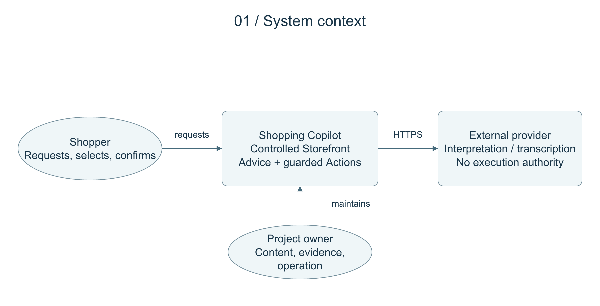

The browser loads the Panel and embeds the Controlled Storefront, whose document contains the Bridge. The Panel and Bridge exchange origin- and source-window-checked messages. The Panel calls the Agent API and receives Server-Sent Events. The Bridge executes a checked Action and returns an ActionResult with a fresh Snapshot. The Storefront owns the cart effect.

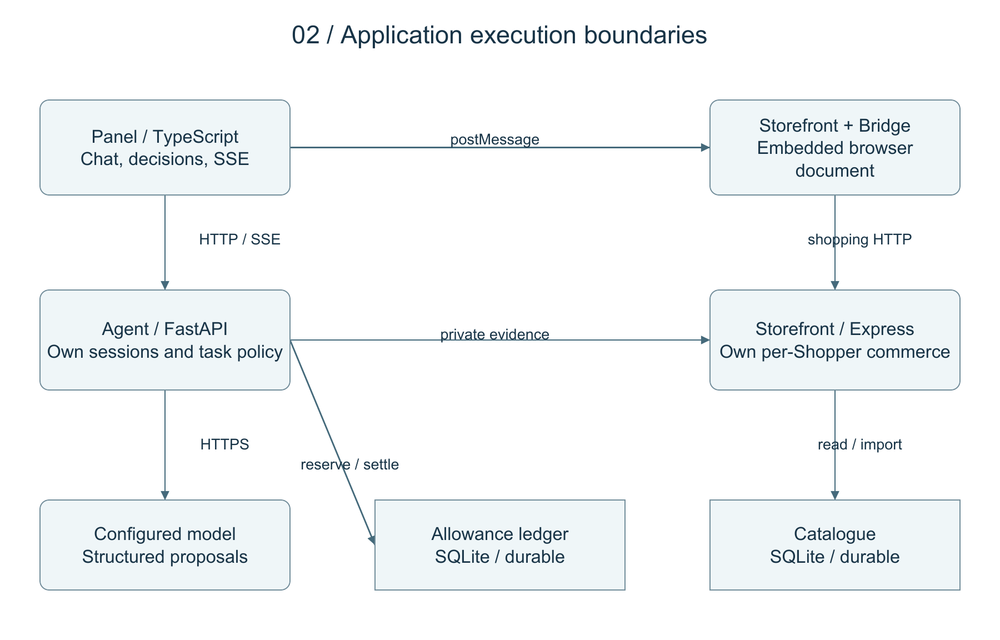

| Component                   | Main sources                                                                                                  | Responsibility                                                                          |
| --------------------------- | ------------------------------------------------------------------------------------------------------------- | --------------------------------------------------------------------------------------- |
| Panel                       | panel.ts, event-stream.ts, shopper-link.ts, admission.ts                                                      | Chat/cards, Confirmation, speech review, Stop, ownership and Bridge coordination        |
| Bridge                      | runtime.ts, snapshot.ts, actions.ts                                                                           | Semantic observation, current-target checks, origin/source validation and DOM execution |
| Agent API                   | agent/app.py, shopper_http.py, shopper_access.py                                                              | HTTP/SSE, Shopper authorization, admission and orchestration                            |
| Session facade/task modules | sessions.py, session_registry.py, task_interpretation.py, task_commands.py, task_results.py, task_recovery.py | Context, interpretation, commands, result identities, Stop and reconciliation           |
| Catalogue/advice            | catalogue_client.py, catalogue_retrieval.py, catalogue_turn.py, advice.py                                     | Bounded retrieval, eligibility, grounded product references and read-only advice        |
| Storefront                  | app.ts, shopper-state.ts, shopper-link.ts, guarded-cart.ts, product-repository.ts                             | Per-Shopper commerce, linking, stock/revision checks and authoritative catalogue        |
| Provider seam               | agent/llm/contract.py, factory.py, openrouter.py, bedrock.py                                                  | Explicit adapter selection, structured proposals, errors/cancellation and usage         |
| Host assembly               | deploy/host_bootstrap.py, host_checks.py, host_component.py                                                   | Protected configuration, native launch, signed readiness and cleanup                    |

SessionStore composes modules rather than distributing the application into a fleet of microservices. Browser target IDs are scoped to observations; they are not durable selectors stored in a database. Local development uses Panel 4100, Storefront 4000 and Agent 8000; production routing is described separately in section 8.

## 4. Data flow, identity and trust

Anonymous browser profiles now have Storefront-owned Shopper bindings and separate carts. Agent sessions require authenticated linking; a copied session ID is insufficient. Host-only Secure/HttpOnly cookies and Origin/CSRF checks constrain browser requests. Sibling HTTPS origins preserve separate DOMs without widening cookies to the parent domain.

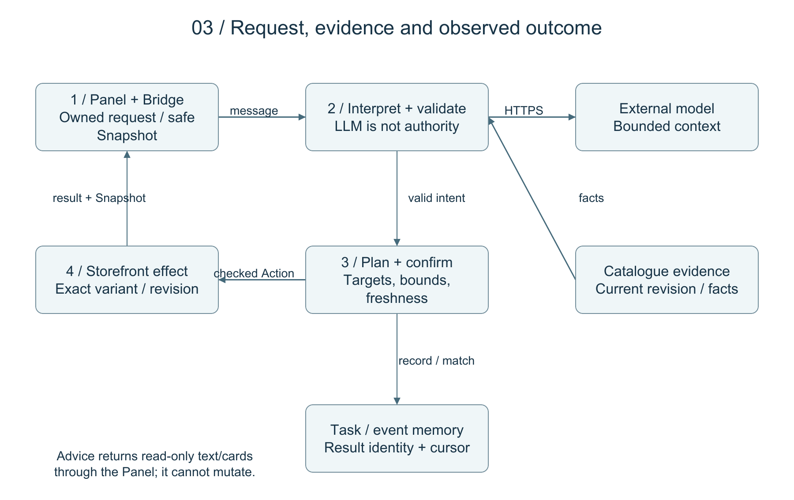

1. Complete the bounded linking flow and authenticate the binding through a private Storefront service. Check session and active-tab ownership before work.
2. Build a semantic Snapshot from permitted page metadata/controls. Exclude Sensitive Field values and arbitrary hidden inputs from model context.
3. Send the request, sanitized observations and bounded history/product context to the explicitly selected model. Validate capability, target, currency, quantity, freshness and authority after interpretation.
4. Retrieve revisioned catalogue evidence through the service contract. Lexical or optional semantic ranking narrows candidates; product facts determine eligibility. Ranking cannot prove an absent property or authorize a mutation.
5. Return read-only advice/cards, or plan executable Actions through Confirmation where required and checked event/Bridge delivery.
6. Accept only matching ActionResults. Missing acknowledgements and disconnects never justify repeating an uncertain Mutation automatically.

DOM text, catalogue descriptions, model replies and browser requests are untrusted data. Service authentication is separate from browser cookies. The public Caddy path allowlist excludes private/test interfaces and removes forwarded service secrets. These prepared controls still require deployed-path verification.

## 5. Data model and storage

The catalogue is an explicitly initialized SQLite database, replacing fixture-only reads. The Storefront owns imports/writes; search/detail responses include revisioned evidence. Unknown properties stay unknown, and Money remains exact at contract boundaries. Native host preparation additionally gives the Agent narrow read-only catalogue/WAL access for verification, never write authority.

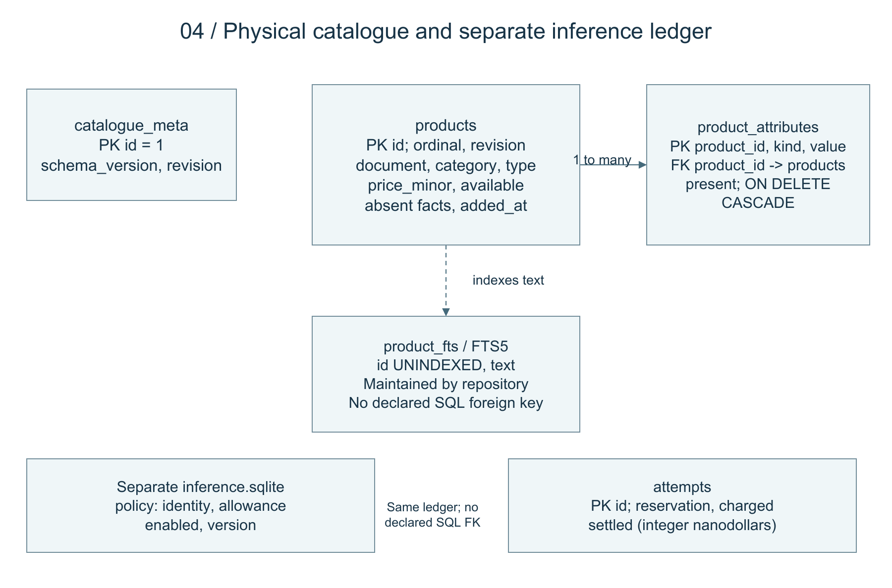

| Store/entity              | Identity and fields                                                                                                     | Storage and authority                                                        |
| ------------------------- | ----------------------------------------------------------------------------------------------------------------------- | ---------------------------------------------------------------------------- |
| catalogue_meta            | singleton id, schema_version, revision                                                                                  | Durable SQLite revision; absent/incompatible database refuses startup        |
| products                  | id, ordinal, revision, document, absent_features, absent_uses, category, product_type, price_minor, available, added_at | Durable records with integer minor-unit prices                               |
| product_attributes        | product_id, kind, value, present; composite key                                                                         | Indexed evidence; foreign key to products with cascading deletion            |
| product_fts               | FTS5 id/text, unicode61 tokenizer                                                                                       | Repository-maintained search index, not separate stock authority             |
| Inference policy/attempts | identity, allowance, enabled; attempt id, reservation, charged, settled                                                 | Separate durable SQLite ledger, integer nanodollars and atomic transactions  |
| Invitations/lifecycle     | store identity, absolute windows, grant counts; host generation/commands/leases                                         | Local SQLite implementations; remote DynamoDB adapters prepared but inactive |
| Shopper/cart/orders       | binding/generation, exact product-size-colour lines and revision                                                        | Per-Shopper Storefront process memory; lost on Store restart/expiry          |
| Session/Shopping Task     | Shopper/session/tab/task IDs, events, accepted results, context/status                                                  | Agent memory; 30-minute inactivity expiry; lost on Agent restart             |
| Confirmation/Undo         | exact proposal/state; prior lines and original expiry                                                                   | Single-use Confirmation up to 60 seconds; Undo ten seconds                   |

There is no invented durable customer/orders database. Commerce/session state remains volatile even though catalogue and operating authorities persist. Product Money crosses contracts as decimal amount plus EGP. SQL filtering uses indexed attributes and integer price_minor.

The proposed DynamoDB control table has string pk/sk keys and conditional writes for invitation/lifecycle identity, revision, generation and command ownership. It is not a product catalogue. Actual cloud identifiers remain unbound. Restoring older authority/allowance state to regain redemptions or inference capacity is prohibited.

## 6. Behavioral design and recovery

### Ordinary Action sequence

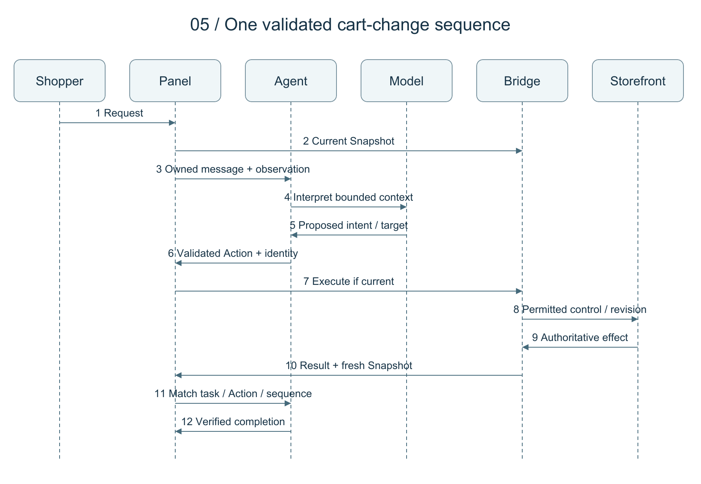

Each Action carries task_id, action_id and sequence_number. The Bridge verifies the current target and destination; the Storefront checks inventory, quantity, variant and relevant state. A task can first navigate to the cart, then reinterpret against its fresh controls. Completion follows actual results rather than the model's success message.

### Guarded Mutation activity

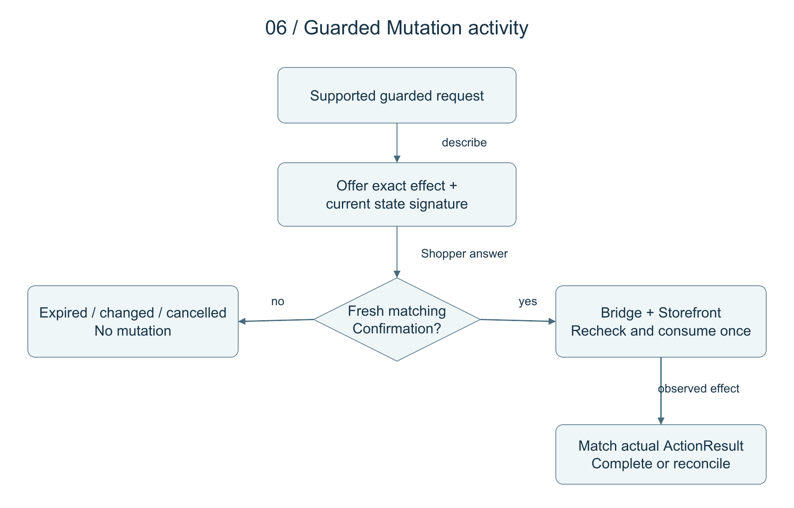

Confirmation describes the exact effect and state signature. Expiry, state change, cancellation, refresh and single-use consumption constrain the offer. An earlier generic “yes” cannot authorize another task. Both Agent and Storefront enforce authority. Ordinary reversible cart edits use Undo rather than terminal Confirmation semantics.

### Shopping Task state

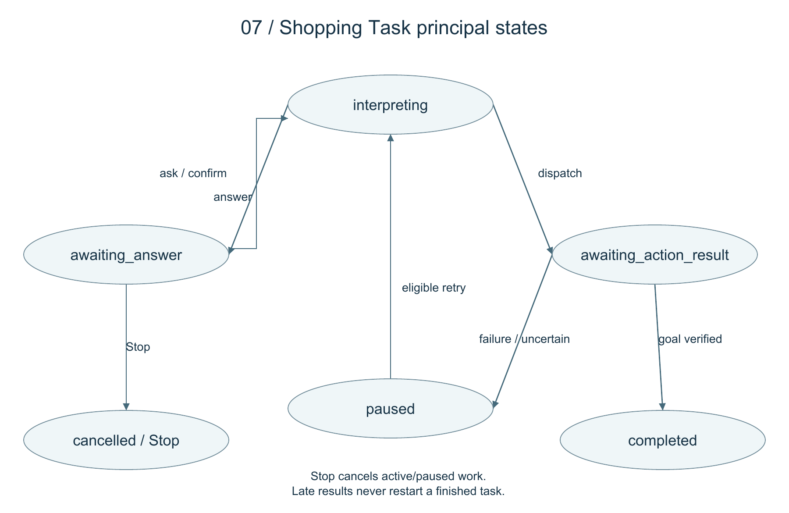

Actual statuses are interpreting, awaiting_action_result, awaiting_answer, completed, cancelled and paused. The figure shows principal transitions; Stop remains reachable from active/paused states. Completed/cancelled tasks cannot restart from an old event. Retry is explicit and cannot replay uncertain work. Refresh reconciles current observations and the browser execution journal.

| Interruption                       | Retained state                                    | Recovery                                                                       |
| ---------------------------------- | ------------------------------------------------- | ------------------------------------------------------------------------------ |
| Browser refresh/reconnect          | Surviving processes/cart and remaining Undo       | Reconcile Snapshot/cursor; invalidate unused Confirmation; suppress duplicates |
| Agent-only restart                 | Surviving Storefront cart/Undo and durable stores | Invalidate old tasks/leases; fresh linking/admission as needed; no replay      |
| Storefront-only restart            | Durable catalogue/operating authorities           | Discard cart/orders/Confirmation/Undo; reject old generation and relink        |
| Full host/code restart             | External durable authorities/state                | Explain volatile reset; never reset allowance or invitation quotas             |
| Unknown provider/lifecycle outcome | Existing reservation/command evidence             | Retain charges/protection; no guessed refunds or repeated commands             |

### Host lifecycle

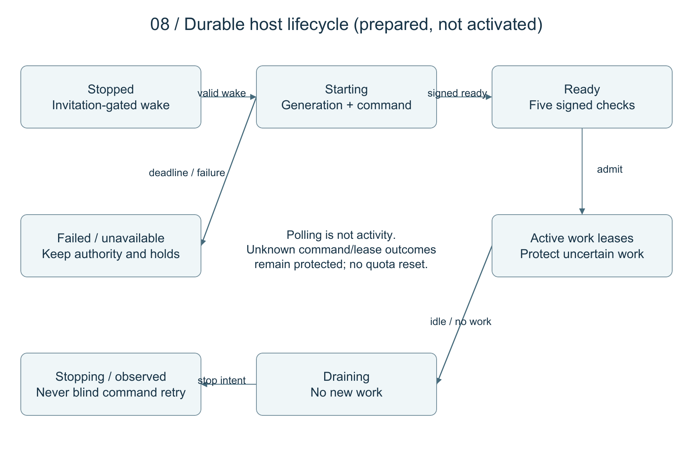

The controller uses durable generation/command ownership for start, observe and stop. Invitation windows and cumulative quotas apply at wake and application admission. EC2 running status and ordinary /health liveness are insufficient readiness. The signed aggregate requires release, Storefront, admission, allowance and provider checks; the default unqualified-provider callback refuses readiness.

Work leases protect active/uncertain operations from idle stop. Background polling is not meaningful Shopper activity. Browser polling cannot ensure reliable shutdown after browsers vanish; the external observation schedule is a separately costed conditional proposal with its own adoption/failure gate. No schedule or host is active merely because its renderer exists.

## 7. Interfaces, versions and module composition

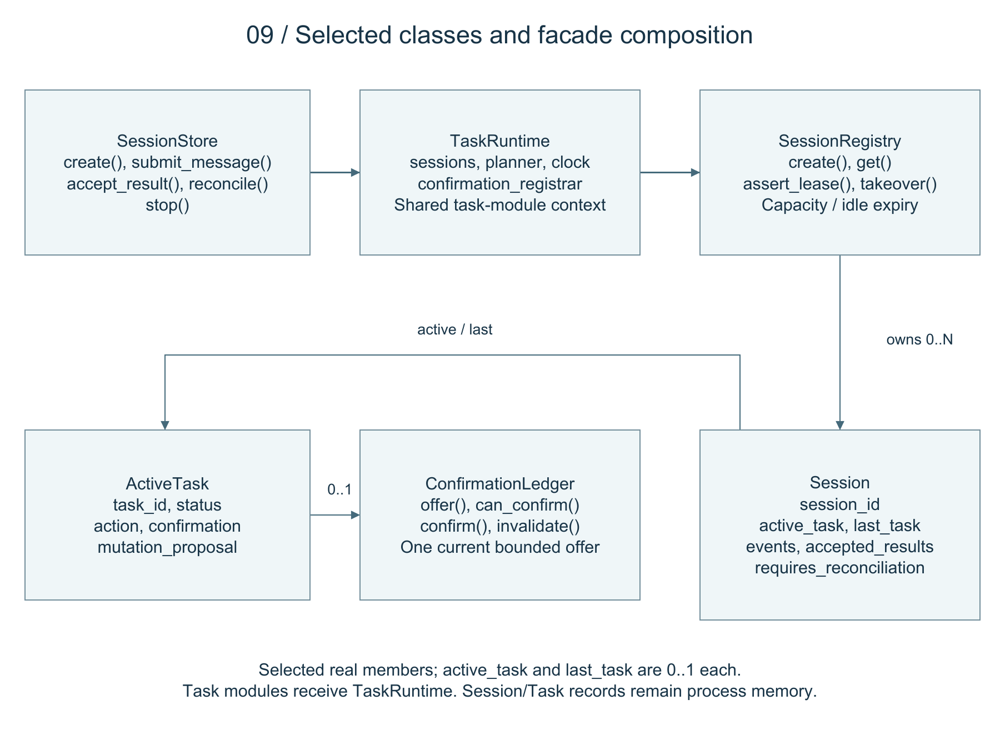

The class view lists selected real members from SessionStore, TaskRuntime, SessionRegistry, Session, ActiveTask and ConfirmationLedger. SessionStore constructs a registry and a shared TaskRuntime for task modules. A registry owns multiple sessions; each Session may reference an active and last task, and each ActiveTask may hold one ConfirmationLedger. These relationships describe process memory, not database tables. Figure 2 and the component table describe the wider module boundaries.

| Interface                | Contract                                                                            | Check/failure boundary                                                |
| ------------------------ | ----------------------------------------------------------------------------------- | --------------------------------------------------------------------- |
| Shopper linking/activity | Browser identity plus authenticated private service                                 | Host-only cookies, Origin/CSRF, generation and ownership              |
| Session API              | POST /sessions; messages, answers, retry, action-results, stop, reconcile, takeover | Authorize every session route; recheck state after external waits     |
| Event stream             | GET /sessions/{session_id}/events; monotonic SSE IDs                                | Cursor reconnect, bounded stream and duplicate suppression            |
| Browser wire             | Snapshot/Action/ActionResult v1                                                     | Strict mirrored Python/TypeScript contracts and shared fixtures       |
| Intent                   | Live schema 9, intent-v32                                                           | Semantic proposal validation, observed targets and bounded repair     |
| Advice                   | advice-v4, response schema 1                                                        | Read-only message/references; malformed output cannot mutate          |
| Provider                 | LLMClient.complete(LLMRequest)                                                      | Explicit adapter; invalid/failed/cancelled output grants no authority |
| Readiness                | Signed proof bound to release and generation                                        | Fixed five checks; invalid proof/unqualified provider refuses         |

The recorded accepted local provider is OpenRouter Gemini 3.5 Flash-Lite. BedrockClient exists behind the same seam and has offline verification; recorded Stockholm diagnostics failed and candidate applied quotas were zero. The owner permits the current OpenRouter fallback if Bedrock is unusable, but selection must be explicit with qualification/accounting preserved. The non-resetting OpenRouter key cap remains **$2**. This report authorizes no switch, extra call or top-up.

Hosted async adapters retain bounded worker capacity through cancellation until actual synchronous SDK work finishes. State/generation are rechecked after waits. This avoids blocking the event loop or treating timeout as success; it cannot forcibly terminate an entered SDK operation.

## 8. Deployment architecture and isolation

### Selected network topology

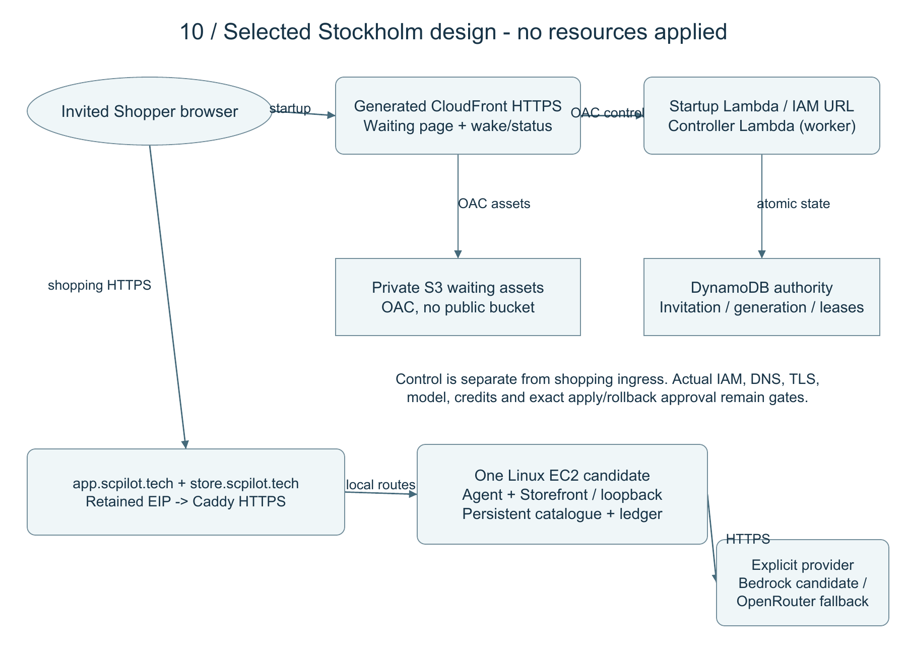

Shopping uses https://app.scpilot.tech for built Panel and Agent HTTP/SSE, and https://store.scpilot.tech for embedded Storefront/Bridge. Direct Caddy HTTPS on one host uses retained addressing. CloudFront's generated HTTPS hostname serves waiting/startup/control, not the shopping iframe/API. This supersedes custom-alias CloudFront/Virginia ACM assumptions blocked by the current Free account without upgrade.

| Resource area           | Selected direction/proposal                                                                 | Acceptance state                                               |
| ----------------------- | ------------------------------------------------------------------------------------------- | -------------------------------------------------------------- |
| Region/plan             | Stockholm eu-north-1, Free plan, zero out-of-pocket                                         | Refresh dated account/credit/eligibility evidence before apply |
| Host                    | One x86_64 t3.small candidate, one Agent worker, encrypted 20 GiB gp3 and retained EIP      | Native runtime/AMI, capacity and exact apply bindings open     |
| Shopping ingress        | Direct Caddy app/store; Agent 8000 and Storefront 4000 loopback                             | DNS, ACME, real security group and browser acceptance open     |
| Startup delivery        | Generated CloudFront name, private S3 assets and IAM Lambda Function URL with separate OACs | Prepared renderers/packages; no resources/policies applied     |
| Control                 | Two proposed Python 3.12 Lambdas and one DynamoDB table                                     | Local implementation; actual initialized authority/IAM unbound |
| Conditional observation | Disabled finite Scheduler, reused controller, bounded metrics/alarms                        | Separate adoption, cost and failure acceptance required        |
| Model                   | Bedrock candidate, explicit current OpenRouter fallback permitted                           | Bedrock quota/qualification open; no calls by this report      |

The base proposal counts three runtime roles, three inline policies and one host profile. A conditional scheduler adds its role/policy only if adopted. Existing shared VPC and registrar authority are not permission to modify unrelated infrastructure. There is no mandatory NAT, ALB, RDS, Redis, WAF, GPU host or account upgrade. Exact quantities, phase bindings, rollback and teardown remain in the apply dossier; this diagram is not a deployable stack.

### Native host process boundaries

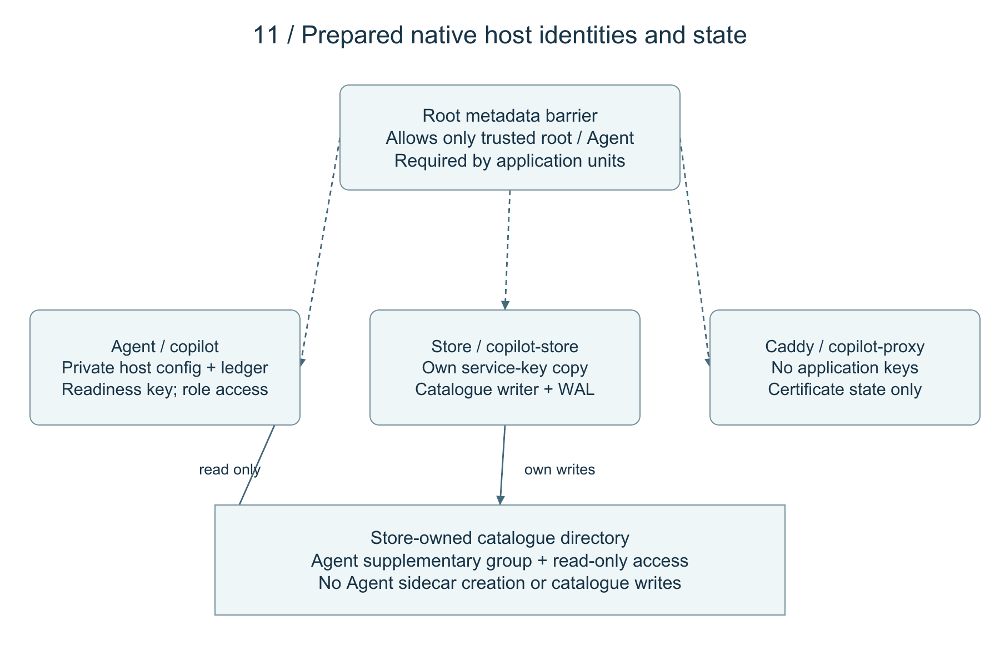

Prepared units separate Agent, Storefront and proxy UIDs and require a trusted-root metadata barrier. Configs and consuming-UID private key files are separate; proxy receives no application key. Only trusted root/Agent may reach role metadata. The nft output barrier rejects other UIDs at IPv4/IPv6 metadata addresses; root remains trusted, and a oneshot's active state cannot detect later root removal of its rules.

The Store owns catalogue writes and WAL/SHM creation; Agent receives read-only group access. Missing sidecars fail closed rather than justify write permissions. Root owns immutable release/interpreter paths; no-new-privileges and service-specific state paths limit modification. Lifecycle hooks emit bounded private fixed-field records, not raw requests/keys/child output. Lifecycle records are not readiness.

Recorded proof used an official AL2023/Python 3.12.15/glibc 2.34 disposable image and synthetic UIDs. Actual systemd 252 boot/dependency/reboot/capability/metadata acceptance remains open. Static systemd 255 validation and Caddy adaptation/captured launch are narrower than installation, public TLS issuance or reboot proof.

## 9. Safety, privacy and operating decisions

| Condition                                   | Design response                                                          | Remaining verification                              |
| ------------------------------------------- | ------------------------------------------------------------------------ | --------------------------------------------------- |
| Off-origin link/form or forged message      | Source-window/origin and destination checks at execution                 | Repeat against actual public origins                |
| Sensitive values/private identities         | Exclude Snapshot values; private linking; redacted bounded logs          | Full deployed prompt/log/error and retention paths  |
| Ambiguous variant/unsupported fact/quantity | Clarify; catalogue stock and exact bounds remain authority               | Finite language coverage; preserve failures         |
| Destructive or terminal change              | Bound fresh Confirmation plus Storefront revision/single-use checks      | Expiry/state-change/replay regressions              |
| Duplicate or uncertain effect               | Identity matching and journal reconciliation                             | Restart/disconnect/cloud routing acceptance         |
| Expired invitation/exhausted allowance      | Absolute windows, cumulative quotas, atomic reservations and kill switch | Current workload, real limits and operator recovery |
| State rollback/loss                         | Compatible code rollback; preserve authority/unknown charges             | Never restore older allowance to regain capacity    |
| Host process interference                   | Separate UIDs, minimal configs, required metadata barrier                | Native provisioning/reboot proof; trusted root      |

The ledger reserves conservative cost before each provider attempt, including repairs. Unknown cost, cancellation or process death retains the reservation. Native provider caps are additional safeguards; alerts are not hard spending caps. The current workload, prices/credits and complete two-month cost envelope must be refreshed and bound before apply. No new quote or spending permission is implied here.

Immutable release verification and compatible code rollback keep catalogue and operating state outside code. SQLite backup uses its consistent backup API, not a copy of an active WAL file. Catalogue restore creates a verified new copy; no allowance/admission restore replenishes quota. Teardown targets only bound project-owned resources, preserving shared network/registrar configuration and required retained state.

## 10. ML and evaluation design

The runtime model interprets language/context; code retains Money, eligibility, stock, Confirmation and Action authority. Optional retrieval representations rank candidates but cannot invent Catalogue Facts. The host bootstrap explicitly selects lexical retrieval, avoiding an unreviewed encoder dependency at deployment.

The offline development comparison has seven families and 46 fits on 210 training / 53 validation / zero unseen examples, all synthetic/exposed. Frozen multilingual embeddings plus Logistic Regression led at 23/53 correct (43.40%), macro-F1 0.4304; TF-IDF plus Logistic Regression scored 20/53, macro-F1 0.3776. Reports/notebook preserve all trials, errors, confusion matrices and timing. Small selected-validation differences are not independent superiority evidence. Offline models never enter the Action path.

A final same-input LLM comparison and independently reviewed unseen set remain open. Intent classification, Constraint extraction, clarification, advice quality, task success, safety and cost require separate denominators. Provider failures and repairs stay in accounting.

The 15 October local replacement qualification recorded 43/44 core tasks, 19/19 safety cases and 7/7 advice conversations, including retained setup interruption/continuation and a cart-increase clarification limitation. That dated local evidence does not establish Bedrock quota, real-host performance or cloud acceptance.

## 11. Requirement-to-design traceability

Local means implemented with dated local evidence; Limited retains capability/provider limits; Partial leaves material acceptance open; Open has no final qualified/deployed result. All IDs preserve the first submission's meanings.

| ID    | Design sections | Verification or evidence                                             | Status  |
| ----- | --------------- | -------------------------------------------------------------------- | ------- |
| FR-01 | 3,4,7,10        | Intent/semantic tests and 15 October record; independent set pending | Partial |
| FR-02 | 4,5             | Catalogue/discovery/retrieval, stock and eligibility regressions     | Local   |
| FR-03 | 4,7,10          | Advice/reference tests and retained live prose limitations           | Limited |
| FR-04 | 3,6             | Navigation/product-context/Bridge/Spotlight cases                    | Local   |
| FR-05 | 5,6             | Exact cart/reversible tests and refresh Undo                         | Local   |
| FR-06 | 6,9             | Confirmation expiry/state binding/replay cases                       | Local   |
| FR-07 | 2,4             | Newest-order/login handback and sensitive exclusion                  | Local   |
| FR-08 | 4,6,7           | Ownership/recovery/SSE cursor and uncertain-journal tests            | Local   |
| FR-09 | 2,7             | Speech availability and Panel fallback checks                        | Limited |
| SQ-01 | 3,4,7           | Model-owned meaning and strict intent boundary tests                 | Local   |
| SQ-02 | 4,9             | Origin/source-window and sensitive browser regressions               | Local   |
| SQ-03 | 5,6,9           | Stock/bounds/revision/Confirmation/duplicate checks                  | Local   |
| SQ-04 | 6,9,10          | Retained failures/unknowns and safe fallback                         | Local   |
| SQ-05 | 7,9,10          | Measurement/allowance tests; cloud workload pending                  | Partial |
| SQ-06 | 4,8,9           | Shopper/private-file/UID/log tests; real-host privacy open           | Partial |
| SQ-07 | 4,9             | Read-only advice and mutation re-entry guards                        | Local   |
| GR-01 | 5,10            | Grouped synthetic release; independent unseen/gold absent            | Partial |
| GR-02 | 10              | Offline artifacts/notebook; final LLM comparison pending             | Partial |
| GR-03 | 8,9             | Selected topology/local renderers; no deployed acceptance            | Open    |
| GR-04 | 7,10            | Offline adapter/failed diagnostics; qualification open               | Open    |
| GR-05 | 1,11,12         | Design artifacts and academic records; acceptance separate           | Partial |

Exact paths and dated evidence appear in the companion views. The latest checkpoint records 1,318 Python and 199 TypeScript passes in the 23 October full run. Those are historical counts; this documentation revision did not rerun the application, access AWS or perform paid inference.

## 12. Deliverable coverage and remaining acceptance

This report and its companion cover actors/use cases, C4-style context/execution boundaries, data flow, sequence/activity/state, physical/conceptual data, module/class composition, APIs, deployment/network, process isolation, wireframes, security/recovery, ML separation and requirement traceability. Key trade-offs are single-host scope, durable catalogue with volatile commerce, explicit providers, separate origins and conservative accounting/recovery.

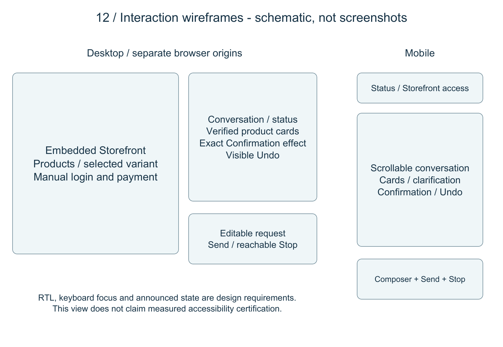

Remaining acceptance: native production runtime/build lock and real systemd/reboot proof; full signed readiness; current account/credit/workload and exact resource/cost/rollback approval; a usable qualified model or explicitly selected accepted fallback; actual DNS/TLS and deployed isolation, recovery, capacity and browser results. These gaps do not prevent documenting the selected design, but prevent claiming an active or production-ready host.

This revision is ready for owner technical review before the 6 November deadline. Exporting it does not publish it, alter the first three submitted reports, create resources, raise caps or authorize deployment.

## 13. Source and evidence index

- [Domain](../CONTEXT.md), [checkpoint](../PROJECT_CHECKPOINT.md), [requirements](cap01-requirements.md), [DEPI guidelines](depi-guideline-alignment.md).
- [Companion diagrams/evidence](system-design-views.md), [rebuild and submission guide](system-design-submission.md), [skill discovery](system-design-skills.md).
- [Shopper isolation](shopper-isolation-verification.md), [session modularity](session-modularity-refactor.md), [local acceptance](../RESULTS.md), [local model qualification](research/2026-10-15-gemini-replacement.md).
- [Offline comparison](cap03-model-comparison-results.md), [executed notebook](../notebooks/cap03-model-comparison.ipynb), [Bedrock access/adapter](cap05-bedrock.md).
- [Cloud specification](cap04-spec.md), [Stockholm amendment](superpowers/specs/2026-10-19-cap04-stockholm-ingress-amendment.md), [account evidence](cap04-account-feasibility.md), [allowance](cap04-inference-allowance.md).
- [Apply proposal](cap06-apply-proposal.md), [inventory](cap06-apply-inventory.json), [host isolation](cap06-host-isolation.md), [bootstrap](cap06-host-bootstrap.md), [signed checks](cap06-host-checks.md), [release/recovery](cap04-release-recovery.md).

Dated operational documents retain historical stages; later amendments/checkpoint govern conflicts. The export manifest records exact source/diagram hashes for this revision. Source inspection supports design accuracy, not new runtime acceptance.
