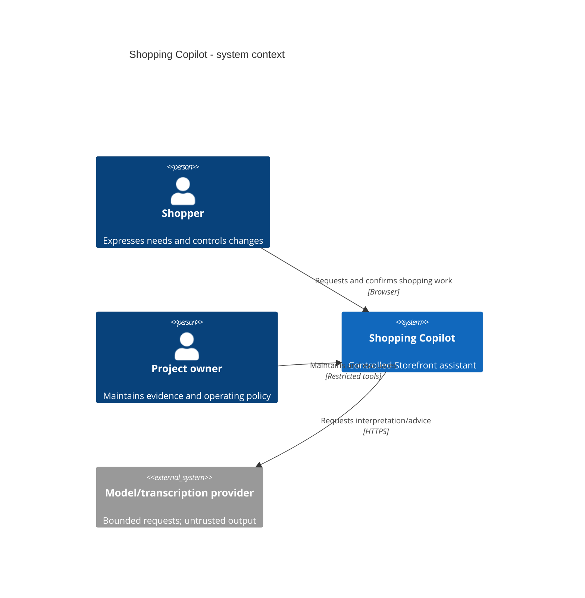
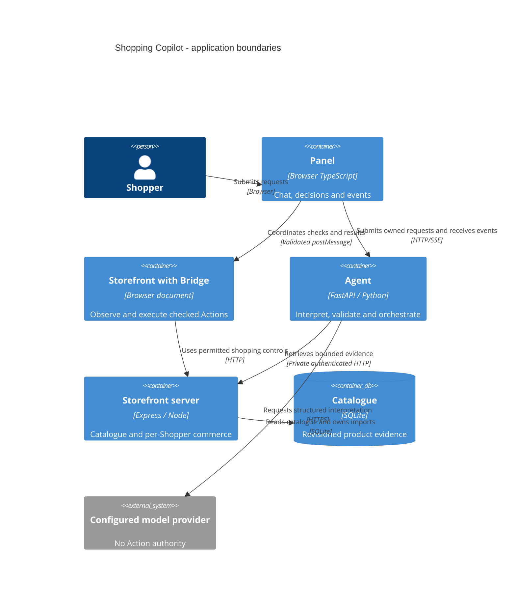

# System design views and evidence reference

Updated: **28 October 2026**. Companion to [document 04](system-analysis-design.md), deadline **6 November 2026**. This revision replaces the shared-cart/fixture-only 2 October supplement. Diagrams are explanatory abstractions of source and selected deployment design; they are not resource-creation instructions or proof of live deployment.

## Diagram catalogue

Every view has an editable `.drawio` source, matching vector figure in the report and a PNG preview under `docs/diagrams/system-design-20261028/`. The diagram set is generated from explicit definitions by `scripts/export_system_design.py`; the report consumes the resulting XML geometry. No diagram is an image-only black box in the editable source.

| Figure | View                     | Question it answers                                                   | Evidence boundary                                                                              |
| ------ | ------------------------ | --------------------------------------------------------------------- | ---------------------------------------------------------------------------------------------- |
| 01     | Context                  | Who uses/maintains the system and which external service is involved? | One Controlled Storefront, not arbitrary retailers                                             |
| 02     | Execution boundaries     | What runs in the browser, Agent and Storefront?                       | Logical processes, not mandatory Docker deployment                                             |
| 03     | Data flow                | How do sanitized requests, evidence and results move?                 | Model/DOM text never grant execution authority                                                 |
| 04     | Data model               | Which catalogue/allowance tables persist?                             | Cart/tasks remain process memory; distinct databases have no fictitious cross-file foreign key |
| 05     | Sequence                 | How does one proposed cart change become an observed effect?          | Abstraction of actual transports; no model-direct browser operation                            |
| 06     | Activity                 | What authorizes or blocks a guarded mutation?                         | Fresh Confirmation, current state and result identities remain required                        |
| 07     | Task state               | How do work, questions, results, pause and Stop relate?               | Principal transitions; not an exhaustive transition table                                      |
| 08     | Host lifecycle           | How do wake, readiness, work and idle stop relate?                    | Durable controller prepared; actual host/schedule unactivated                                  |
| 09     | Class/facade composition | Which real classes compose session/task control?                      | Selected source members and cardinalities; not persistence tables                              |
| 10     | Cloud deployment         | Which entry path serves startup versus shopping?                      | Direct app/store Caddy; generated CloudFront only waiting/control                              |
| 11     | Host isolation           | Who can read keys/state and reach instance metadata?                  | Synthetic UID/Linux proof; actual systemd host acceptance remains open                         |
| 12     | Wireframes               | Where are chat, cards, Confirmation, Stop and the Storefront?         | Schematic implemented interaction, not pixel-perfect screenshots                               |

## Architecture notation

Filled rectangles represent application processes, components or data stores as stated in each label. Ellipses denote actors/states, diamonds denote decisions, and bordered tables denote physical or conceptual fields. Solid arrows are directional interactions. A dashed boundary marks a trust/execution grouping; it does not imply deployment success. Figure descriptions state whether the view is implemented or proposed.

The two C4 levels also have concise Mermaid editing sources below. The exported PDF embeds their matching native figures 1 and 2.

## Conceptual relationships and physical schema

One Shopper binding owns its process-local cart/orders and can link multiple bounded Agent sessions. A session holds active/last task, events, accepted result identities, product context and tab ownership. A task proposes Actions and can hold a Confirmation offer. A cart holds exact variant lines plus at most the current eligible Undo record. These are logical relationships, not a claim that a durable SQL session/cart table exists.

Physical SQLite catalogue tables are defined in `store/src/catalogue-db.ts`: catalogue_meta, products, product_attributes and product_fts. Product attributes reference products with cascade deletion; FTS id is an indexed search identity maintained by code, not a foreign key. Exact indexes and schema version are preserved in source. The separate inference ledger in `agent/inference/ledger.py` has policy and attempts; a database-level relationship between those tables is not invented.

Local invitation/lifecycle SQLite implementations support explicit initialization and tests. The prepared cloud implementation uses conditional DynamoDB items with a shared namespace and pk/sk keys. This is separate operating authority, not commerce storage. Missing/replaced authorities refuse instead of silently initializing a fresh quota or lifecycle generation.

## Sequence and state details

The sequence view uses Shopper, Panel, Agent, configured model, Bridge and Storefront participants. A real task may include a fresh-cart navigation and a second interpretation before mutation. Model calls may require one bounded repair; every provider attempt is independently accounted. The figure intentionally shows one valid path, with clarification/refusal discussed in the main report.

The task-state diagram uses the exact `TaskStatus` names in `agent/session_state.py`. Stop may cancel any active/paused state; duplicate result delivery is idempotent or stale, never a new effect. The host lifecycle is a different state machine: its durable generation/command/work-lease state must not be confused with a Shopper task's status.

## UI and accessibility intent

The desktop schematic places the embedded Storefront beside the conversation and a reachable composer/Stop area. The mobile schematic preserves chat, current task status, decisions and access to the Storefront without hiding Stop behind an overflowing transcript. Product cards and Confirmation describe the actual choice; payment/login remain direct Shopper input.

RTL and localized labels, keyboard focus, semantic controls, status announcements and reduced-motion behavior belong to the implemented interface. These references do not certify WCAG conformance or measured mobile-device usability. Exact CSS/DOM comes from `panel/src/styles.css`, `panel/src/panel.ts`, `panel/index.html` and `store/public/store.css`.

## Verification index

| Area                       | Representative existing verification files                                                                              | Scope of evidence                                                                           |
| -------------------------- | ----------------------------------------------------------------------------------------------------------------------- | ------------------------------------------------------------------------------------------- |
| Language/targets           | agent/tests/test_intent_pipeline.py; test_semantic_boundary.py; test_product_context.py                                 | Scripted boundaries are distinct from recorded real-model language results                  |
| Catalogue/retrieval/advice | agent/tests/test_catalogue.py; test_advice.py; store/tests/catalogue.test.ts                                            | Exact eligibility, reference checks, malformed advice and data consistency                  |
| Cart/Confirmation          | agent/tests/test_cart_task.py; test_confirmation.py; eval/tests/test_ticket11_cart.py; test_ticket10_guarded_browser.py | Exact lines, Undo, stock/bounds, guarded expiry and replay                                  |
| Origin/privacy             | bridge/tests/safety-review.test.ts; eval/tests/test_ticket09_safety.py                                                  | Visible/hidden attack content, Sensitive Fields and off-origin execution                    |
| Ownership/recovery         | agent/tests/test_recovery.py; panel/tests/event-stream.test.ts; eval/tests/test_ticket14_spa.py                         | Tab lease, fresh observations, SPA/reconnect and uncertain-outcome protection               |
| Model/accounting           | agent/tests/test_openrouter.py; test_bedrock.py; eval/tests/test_usage_reconciliation.py                                | Adapter error/cancellation and retained measurements, not live cloud quota                  |
| Host implementation        | deploy/ and eval/evidence/cap06-host-isolation-20261023.json                                                            | See exact disposable UID/WAL/metadata/log/static-unit proof and remaining native host gates |
| Full recorded regression   | PROJECT_CHECKPOINT.md, 23 October section                                                                               | 1,318 Python and 199 TypeScript passes; not repeated by this report update                  |
| Live local model           | docs/research/2026-10-15-gemini-replacement.md                                                                          | 43/44 core, 19/19 safety, 7/7 advice; failed cohorts and continuation retained              |
| Offline ML                 | docs/cap03-model-comparison-results.md; notebooks/cap03-model-comparison.ipynb                                          | Synthetic/exposed 210/53/0; validation-selected results, no independent test claim          |

The first three submitted reports remain fixed historical artifacts. This document updates design evidence for the next deadline; it does not silently amend those submissions or upload the new report.
